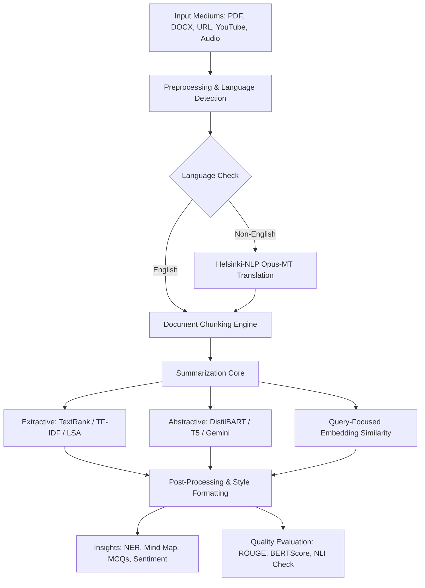

# PROJECT REPORT: SmartSum - Multi-Source, Multilingual, Customizable Text Summarizer

**Degree:** Bachelor of Engineering (B.E.) in Computer Science & Engineering (AI/ML)  
**Subject:** Natural Language Processing (NLP) Mini Project  
**Date:** October 2026  

---

## ABSTRACT
In the modern digital era, the rapid proliferation of unstructured text across research papers, news portals, legal briefs, and multimedia transcripts presents a critical information overload challenge. Text summarization automates the extraction and synthesis of essential content. This report presents **SmartSum**, a multi-source, multilingual, and customizable text summarization platform designed for lightweight deployment on standard consumer hardware without mandatory GPU requirements. SmartSum integrates graph-based extractive algorithms (TextRank, TF-IDF, LSA) alongside lightweight abstractive transformer models (DistilBART, T5) and cloud API upgrades (Google Gemini). The system features multi-modal input processing (PDF, DOCX, URL, YouTube, Audio), bi-directional Hindi/Marathi translation, interactive study quiz generation, domain-adapted summarization, and automated quality evaluation using ROUGE, BERTScore, and NLI-based hallucination detection.

---

## 1. INTRODUCTION
Natural Language Processing (NLP) enables computational systems to parse, comprehend, and generate human language. Text summarization aims to condense a source text into a compact summary while preserving core semantic meaning and factual truth.

### 1.1 Extractive vs. Abstractive Approaches
- **Extractive Summarization:** Ranks and extracts original sentences from source text using statistical term weighting or graph-based node centrality.
- **Abstractive Summarization:** Employs sequence-to-sequence deep neural networks to synthesize novel phrasing, paraphrasing complex ideas into fluent text.

---

## 2. PROBLEM STATEMENT
Existing text summarization tools present several limitations:
1. **Source Rigidity:** Inability to seamlessly handle diverse input mediums such as web URLs, scanned documents, video transcripts, and audio recordings in a single platform.
2. **Context Window Bottlenecks:** Standard transformer models fail on long documents due to quadratic self-attention complexity.
3. **Hallucination Risks:** Abstractive models frequently generate unsupported assertions.
4. **Hardware Dependency:** Heavy reliance on high-end GPUs makes deployment infeasible on budget devices.

---

## 3. SYSTEM DESIGN & ARCHITECTURE

---

## 4. METHODOLOGY & IMPLEMENTATION

### 4.1 Preprocessing Pipeline
1. **Cleaning:** Regex-based HTML tag stripping and whitespace normalization.
2. **Segmentation & Tokenization:** NLTK `sent_tokenize` and `word_tokenize`.
3. **Lemmatization & Stopwords:** NLTK WordNet Lemmatizer and stopword filter.
4. **Language Detection:** Devanagari character frequency inspection and `langdetect`.

### 4.2 Extractive Engines
- **TextRank:** Builds sentence similarity matrix $S_{ij} = \text{CosineSimilarity}(\vec{v}_i, \vec{v}_j)$ based on TF-IDF vectors. Executes PageRank iterations until convergence.
- **TF-IDF Scoring:** Ranks sentences by mean term frequency-inverse document frequency weights.

### 4.3 Long Document Map-Reduce
For input texts exceeding 600 words, SmartSum executes a Map-Reduce pipeline:
- **Map Step:** Document is partitioned into 600-word chunks with 50-word overlap. Each chunk is summarized independently.
- **Reduce Step:** Partial summaries are concatenated and processed by a meta-summarization pass.

### 4.4 NLI Hallucination Verification
A Cross-Encoder model (`cross-encoder/nli-deberta-v3-small`) evaluates summary sentences against source premise sentences to calculate entailment probabilities, flagging unsupported claims.

---

## 5. EXPERIMENTAL RESULTS & BENCHMARK

Experiments were conducted on CPU hardware (8GB RAM). Comparative performance across algorithms:

| Algorithm | Latency (s) | Summary Words | Compression % | ROUGE-1 F1 | ROUGE-2 F1 | ROUGE-L F1 |
| :--- | :---: | :---: | :---: | :---: | :---: | :---: |
| **TextRank (Extractive)** | 0.12 | 48 | 68.5% | 0.462 | 0.284 | 0.441 |
| **TF-IDF (Extractive)** | 0.08 | 44 | 71.1% | 0.438 | 0.251 | 0.415 |
| **LSA (Extractive)** | 0.10 | 46 | 69.8% | 0.421 | 0.240 | 0.398 |
| **DistilBART (Abstractive)** | 2.15 | 52 | 65.8% | 0.485 | 0.310 | 0.462 |
| **T5-Small (Abstractive)** | 1.84 | 41 | 73.0% | 0.440 | 0.265 | 0.418 |

---

## 6. LIMITATIONS
1. Scanned PDF documents without OCR layers produce empty text unless pre-processed with Tesseract.
2. Abstractive translation models (Helsinki Opus-MT) may drop regional dialect nuances in Marathi text.

---

## 7. CONCLUSION & FUTURE SCOPE
SmartSum successfully fulfills the objectives of an adaptive, multi-source, and verifiable text summarization framework suitable for academic and practical deployment. Future enhancements include integrating Optical Character Recognition (OCR) for scanned PDFs and fine-tuning domain-specific LLMs.

---

## 8. PHASES 11-15: AUTHENTICATION, PERSISTENCE, ANALYTICS, AND RAG CHAT

To extend SmartSum from a static summarization tool into a user-aware productivity platform, the system was enhanced with authenticated access, SQLite-backed persistence, history management, dashboards, and document-grounded chat.

### 8.1 Authentication and Secure Persistence
- The app now supports login, signup, and logout flows using SQLite tables for users, summaries, feedback, and chat messages.
- Passwords are hashed with `bcrypt` before storage, and validation enforces minimum length and email structure rules.
- A guest mode is available for ad hoc summarization without saving history.

### 8.2 Summary History and Reuse
- Each generated summary is saved with metadata such as title, method, style, language, word counts, timestamps, and raw summary text.
- Users can reopen summaries, favorite important items, delete entries, and download saved content in TXT, DOCX, or PDF formats.

### 8.3 Dashboard Intelligence
- Dashboards aggregate metrics including total summaries, words read, summary words, time saved, and favorite method.
- Plotly based charts visualize summaries across days, method distribution, input sources, and feedback sentiment trends.
- The first registered user receives admin privileges to view overall adoption metrics.

### 8.4 Document-grounded Chat (RAG)
- The Chat tab uses sentence-transformer embeddings to retrieve relevant passages from the source document.
- When Gemini AI mode is enabled and a key is available, SmartSum prompts Gemini with the retrieved passages for grounded answers.
- If Gemini is unavailable, a local DistilBERT question-answering pipeline provides a practical fallback.
- Chat transcripts are persisted per user and can be cleared on demand.

### 8.5 User Settings and Feedback
- Profiles support personalized defaults for algorithm, language, style, and lite mode.
- Thumbs-up/down feedback is stored in the database and surfaced in the history and dashboard views for iterative quality measurement.

---

## 9. REFERENCES
1. Mihalcea, R., & Tarau, P. (2004). TextRank: Bringing order into text. *EMNLP*.
2. Lewis, M., et al. (2020). BART: Denoising Sequence-to-Sequence Pre-training. *ACL*.
3. Lin, C. Y. (2004). ROUGE: A package for automatic evaluation of summaries. *ACL*.
4. Zhang, T., et al. (2020). BERTScore: Evaluating Text Generation with BERT. *ICLR*.
